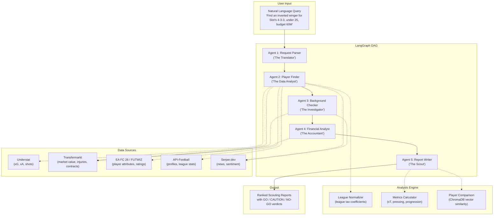
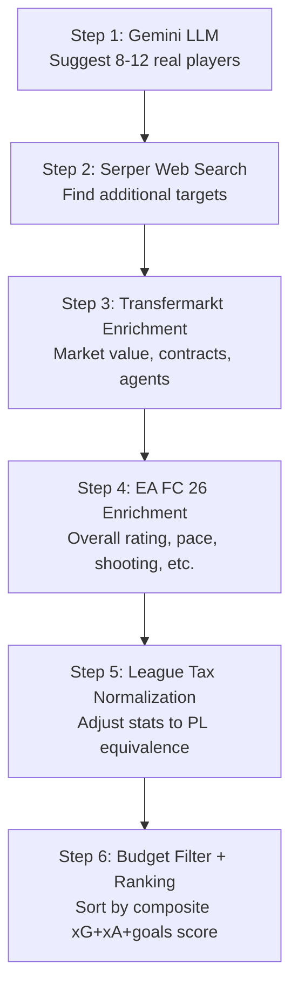
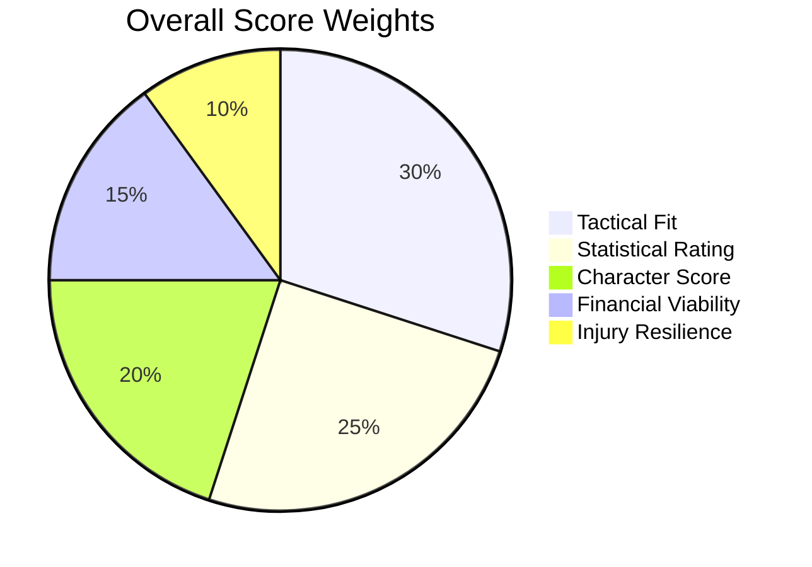
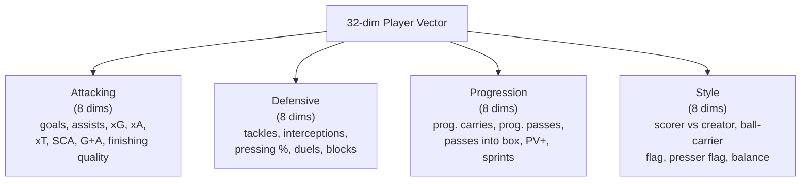
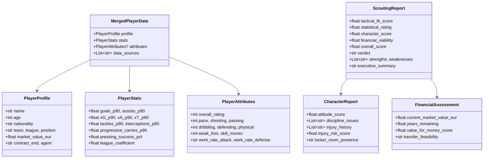

# AI Scout — Multi-Agent Football Scouting System

> **A production-grade, LLM-powered scouting pipeline that identifies, evaluates, and ranks transfer targets for Premier League clubs using live data from 5 free sources and Google Gemini.**

---

## Table of Contents

1. [Project Overview](#project-overview)
2. [System Architecture](#system-architecture)
3. [Multi-Agent Pipeline (LangGraph DAG)](#multi-agent-pipeline)
4. [Agent Breakdown](#agent-breakdown)
5. [Data Sources](#data-sources)
6. [Analysis Engine](#analysis-engine)
7. [Data Models](#data-models)
8. [Caching Strategy](#caching-strategy)
9. [Technology Stack](#technology-stack)
10. [Usage & CLI](#usage--cli)
11. [Configuration](#configuration)
12. [Project Structure](#project-structure)

---

## Project Overview

**AI Scout** is a multi-agent AI system that replicates the workflow of a professional football scouting department. Given a natural-language query like:

```
"Find an inverted winger for Slot's Liverpool 4-3-3, under 25, budget 60M"
```

The system autonomously:
1. **Parses** the query into structured tactical, financial, and positional constraints
2. **Identifies** 8–12 real-world player candidates using LLM knowledge + web search
3. **Enriches** each candidate with live stats from Understat, Transfermarkt, EA FC 26, and API-Football
4. **Normalizes** stats across leagues using a "league tax" coefficient system
5. **Investigates** character, discipline, and injury histories via news analysis
6. **Assesses** financial viability including market value, contract leverage, and value-for-money
7. **Generates** ranked scouting reports with a **GO / CAUTION / NO-GO** verdict and LLM-written executive summaries

The entire pipeline runs as a **LangGraph directed acyclic graph (DAG)**, where 5 specialized agents pass structured state through a shared `ScoutingState` TypedDict.

### Key Design Principles

| Principle | Implementation |
|---|---|
| **Cost-effective** | Uses only free-tier APIs (Understat, Transfermarkt scraping, FUTWIZ scraping, API-Football free tier, Serper.dev free tier) |
| **Modular agents** | Each agent is an independent Python module with a clear input/output contract |
| **Graceful degradation** | System works with zero API keys (fallback keyword parsing), gets better with each key added |
| **Real-world data** | Every stat is sourced from live 2024–26 season data, not synthetic |
| **Premier League calibration** | All stats are league-tax-adjusted to PL equivalence before scoring |

---

## System Architecture



---

## Multi-Agent Pipeline

The core pipeline is built on **LangGraph**, a state-machine framework for LLM applications. The workflow is defined in [scout_workflow.py](file:///c:/AI_scout/agents/scout_workflow.py) and compiles into a sequential DAG.

### Pipeline Flow


### Shared State

All agents read from and write to a **typed shared state** (`ScoutingState`), which uses Python `TypedDict` with `Annotated[List, operator.add]` reducers so that list fields accumulate across nodes instead of overwriting.

```python
class ScoutingState(TypedDict):
    user_request: str
    tactical_system: Optional[str]
    position: Optional[str]
    budget_max: Optional[float]
    search_constraints: Optional[Dict]
    benchmark_player: Optional[str]
    key_attributes: Optional[List[str]]
    candidate_pool: Annotated[List[Dict], operator.add]
    character_reports: Annotated[List[Dict], operator.add]
    financial_assessments: Annotated[List[Dict], operator.add]
    scouting_reports: Annotated[List[Dict], operator.add]
    messages: Annotated[List, operator.add]
    errors: Annotated[List[str], operator.add]
```

---

## Agent Breakdown

### Agent 1: Request Parser — "The Translator"

> [!NOTE]
> **File**: [request_parser.py](file:///c:/AI_scout/agents/request_parser.py) · **Input**: Raw query string · **Output**: Structured search constraints

**Purpose**: Converts a free-form scouting request into a structured JSON schema that downstream agents consume.

**How it works**:
1. If **Gemini is available**: sends the query to Gemini with a system prompt that forces JSON output containing `position`, `tactical_system`, `budget_max`, `benchmark_player`, `key_attributes`, `target_leagues`, `max_age`, and `min_minutes`.
2. If **Gemini is unavailable**: falls back to a **keyword-based regex parser** that detects positions ("striker", "inverted winger"), budgets ("60M"), ages ("under 25"), and tactical systems ("Slot", "Guardiola").

**Extracted fields**:

| Field | Example | Fallback |
|---|---|---|
| `position` | `"inverted winger"` | Keyword map lookup |
| `tactical_system` | `"Arne Slot 4-3-3"` | Pattern matching on manager names |
| `budget_max` | `60.0` | Regex `(\d+)\s*m` |
| `max_age` | `25` | Regex `under\s+(\d+)` |
| `key_attributes` | `["pace", "pressing"]` | Empty list |
| `target_leagues` | `["La Liga", "Bundesliga"]` | Empty list (search all) |

---

### Agent 2: Player Finder — "The Data Analyst"

> [!NOTE]
> **File**: [player_finder.py](file:///c:/AI_scout/agents/player_finder.py) · **Input**: Search constraints · **Output**: Enriched candidate pool (up to 15 players)

**Purpose**: Identifies real-world transfer targets and enriches them with live data.

**Pipeline**:



**Key implementation details**:
- Gemini is prompted to return structured JSON with realistic per-90 stats for each candidate
- Candidates are de-duplicated by name (case-insensitive) when merging LLM + web search results
- Transfermarkt enrichment adds `market_value_eur`, `contract_end_date`, and `agent`
- EA FC 26 enrichment adds `ea_overall`, `ea_pace`, `ea_shooting`, `ea_passing`, `ea_dribbling`, `ea_defending`, `ea_physical`
- League tax is applied using a coefficient map (see [Analysis Engine](#analysis-engine))
- Final pool is capped at **15 candidates** sorted by `xG/90 + xA/90 + goals/90 * 0.5`

---

### Agent 3: Background Checker — "The Investigator"

> [!NOTE]
> **File**: [background_checker.py](file:///c:/AI_scout/agents/background_checker.py) · **Input**: Candidate pool · **Output**: Character reports for top 10

**Purpose**: Performs due diligence on each candidate's character, discipline, and injury history.

**Three-pronged investigation**:

| Source | What It Checks | Implementation |
|---|---|---|
| **Transfermarkt Injuries** | Full injury history, days missed, recurring soft-tissue issues | Scrapes injury page; calculates `injury_risk_score` (0–10) based on total days missed and soft-tissue recurrence |
| **Serper.dev News** | Character articles, controversy reports, transfer rumors | Searches 3 query types: `character`, `injury`, `transfer` |
| **Gemini Sentiment Analysis** | Attitude score, discipline issues, maturity, locker room presence | LLM analyzes up to 8 news articles and returns structured JSON assessment |

**Injury Risk Scoring Algorithm**:
```
180+ days missed in 24 months → 9.0/10
90-180 days                   → 7.0/10
45-90 days                    → 5.0/10
14-45 days                    → 3.0/10
<14 days                      → 1.0/10
+2.0 bonus if ≥3 soft-tissue injuries (hamstring, calf, muscle, groin, thigh)
```

**Discipline adjustments**:
- Each red card reduces attitude score by 1.5 points
- 8+ yellow cards reduces attitude score by 1.0 point

---

### Agent 4: Financial Analyst — "The Accountant"

> [!NOTE]
> **File**: [financial_analyst.py](file:///c:/AI_scout/agents/financial_analyst.py) · **Input**: Candidate pool + budget · **Output**: Financial assessments for top 10

**Purpose**: Evaluates transfer feasibility, market value accuracy, wage estimates, and value-for-money.

**What it calculates**:

| Metric | Method |
|---|---|
| `current_market_value_eur` | Transfermarkt scrape; fallback: stat-based estimation |
| `estimated_wage_weekly_eur` | Heuristic based on market value × age-based factor (€2,000–3,500 per €M) |
| `years_remaining` | Parsed from contract end date |
| `value_for_money_score` (0–100) | `(output × age_factor × contract_factor) / (market_value / 10)` |
| `transfer_feasibility` | Easy (≤60% budget) / Moderate (≤90%) / Tight (≤100%) / Over budget |

**Fallback Market Value Estimation** (when Transfermarkt data is missing):
```
base = 15M
  + goals/90 × 25
  + assists/90 × 18
  + xG/90 × 12
  + xA/90 × 10
  × age_multiplier (1.4 for <22, 1.2 for <25, 0.5 for 30+)
  × league_multiplier (1.5 for PL, 0.75 for Primeira Liga, etc.)
```

---

### Agent 5: Report Writer — "The Scout"

> [!NOTE]
> **File**: [report_writer.py](file:///c:/AI_scout/agents/report_writer.py) · **Input**: All data from previous agents · **Output**: Final ranked scouting reports

**Purpose**: Synthesizes all data into comprehensive scouting reports with a final verdict.

**Scoring formula (weighted composite)**:



| Component | Weight | Range | How Computed |
|---|---|---|---|
| Tactical Fit | **30%** | 0–100 | System-specific stat weights (e.g., Slot → xT + progressive carries + pressing) |
| Statistical Rating | **25%** | 0–100 | Weighted sum of goals, assists, xG, xA, xT, tackles, pressing |
| Character Score | **20%** | 0–10 → scaled to 100 | From Background Checker attitude score |
| Financial Viability | **15%** | 0–100 | Value-for-money score from Financial Analyst |
| Injury Resilience | **10%** | 0–10 → inverted → scaled to 100 | `(10 - injury_risk) × 10` |

**Verdict thresholds**:
- **GO ✅**: Overall ≥ 75 AND injury risk < 5
- **CAUTION ⚠️**: Overall ≥ 55
- **NO-GO ❌**: Overall < 55

**Tactical Fit — system-specific weights**:

| System | Key Stats |
|---|---|
| **Arne Slot 4-3-3** | xT/90, progressive carries, pressing success %, passes into penalty area |
| **Guardiola Possession** | PV+, shot-creating actions, progressive passes, passes into penalty area |
| **Arteta Arsenal** | xT/90, progressive carries, tackles, pressing success % |
| **Conte 3-5-2** | Tackles, interceptions, sprints, goals |
| **General** | G+A, xT, tackles |

**Additional outputs per player**:
- Strengths (up to 5, auto-detected from stats)
- Weaknesses (up to 4, detected from deficiencies)
- Risk factors (character, injury, financial)
- Similar players (via ChromaDB vector comparison)
- Executive summary (LLM-written 3–4 sentence narrative)

---

## Data Sources

### Data Flow Diagram

```mermaid
flowchart LR
    subgraph Free – No API Key
        A["Understat<br/>xG, xA, shots, key passes<br/>5 leagues"]
        B["Transfermarkt<br/>Market value, contracts,<br/>injuries, agents"]
        C["FUTWIZ / EA FC 26<br/>Overall rating, 6 core<br/>attributes, work rates"]
    end

    subgraph Free Tier – Key Required
        D["API-Football<br/>100 req/day<br/>Profiles, league stats"]
        E["Serper.dev<br/>2,500 searches/month<br/>News, sentiment"]
    end

    subgraph LLM
        F["Google Gemini<br/>gemini-2.5-flash<br/>Parsing, candidates,<br/>sentiment, summaries"]
    end

    A --> G["Player Finder"]
    B --> G
    B --> H["Background Checker"]
    B --> I["Financial Analyst"]
    C --> G
    D --> G
    E --> G
    E --> H
    F --> J["Request Parser"]
    F --> G
    F --> H
    F --> K["Report Writer"]
```

### Source Details

| Source | Type | Key Required? | Data Provided | TTL Cache |
|---|---|---|---|---|
| **Understat** | Web scraping (JSON API + HTML fallback) | ❌ No | xG, xA, npxG, xGChain, xGBuildup, shots, key passes | 24 hours |
| **Transfermarkt** | Web scraping (BeautifulSoup + lxml) | ❌ No | Market value (€M), contract end date, agent, injury history (days missed, injury type) | 7 days |
| **FUTWIZ (EA FC 26)** | Web scraping (BeautifulSoup) | ❌ No | Overall rating, pace, shooting, passing, dribbling, defending, physical, work rates, weak foot, skill moves | 72 hours |
| **API-Football** | REST API (api-sports.io) | ✅ Free tier | Player profiles, goals, assists, tackles, interceptions, cards, minutes | 24 hours |
| **Serper.dev** | REST API (Google SERP) | ✅ Free tier | Character news, injury updates, transfer rumors | 12 hours |
| **Google Gemini** | LLM API (langchain-google-genai) | ✅ Free tier | Query parsing, candidate suggestion, sentiment analysis, executive summaries | — |

### BaseSource Interface

All data sources implement [base_source.py](file:///c:/AI_scout/data_sources/base_source.py):

```python
class BaseSource(ABC):
    source_name: str

    @abstractmethod
    async def search_players(...) -> List[Dict]:
        """Filter and return matching players."""

    @abstractmethod
    async def get_player_stats(player_name, season) -> Optional[Dict]:
        """Get detailed stats for one player."""
```

---

## Analysis Engine

### League Normalizer ("League Tax")

**File**: [league_normalizer.py](file:///c:/AI_scout/analysis/league_normalizer.py)

The fundamental insight: 0.5 goals/90 in the Eredivisie ≠ 0.5 goals/90 in the Premier League.

**League Coefficients** (1.0 = Premier League):

| League | Coefficient | Tax on Offense | Boost on Defense |
|---|---|---|---|
| Premier League | 1.00 | ×1.00 | ×1.00 |
| La Liga | 0.88 | ×0.88 | ×1.04 |
| Bundesliga | 0.87 | ×0.87 | ×1.04 |
| Serie A | 0.85 | ×0.85 | ×1.05 |
| Ligue 1 | 0.78 | ×0.78 | ×1.07 |
| Eredivisie | 0.70 | ×0.70 | ×1.10 |
| Primeira Liga | 0.68 | ×0.68 | ×1.11 |
| Championship | 0.65 | ×0.65 | ×1.12 |
| MLS | 0.60 | ×0.60 | ×1.13 |
| Saudi Pro League | 0.55 | ×0.55 | ×1.15 |

**Offensive metrics taxed**: goals/90, assists/90, xG/90, xA/90, xT/90, shot-creating actions, progressive carries, passes into penalty area, PV+, key passes

**Defensive metrics boosted**: tackles/90, interceptions/90, pressing success %, defensive duel win rate, blocks/90. Formula: `scale = 1 + (1 - coefficient) / 3`

**League Adaptability Score** (0–100): Predicts PL adaptation based on league quality + age window (21–27 = +10) + multi-league experience (+5 per top-tier league, max +15).

---

### Metrics Calculator

**File**: [metrics_calculator.py](file:///c:/AI_scout/analysis/metrics_calculator.py)

Computes advanced metrics from raw data:

| Metric | Formula | Use Case |
|---|---|---|
| **Expected Threat (xT)** | 12×8 grid mapping pitch zones to goal probability; xT = threat(end) – threat(start) | Measures ball progression value |
| **Possession-adjusted tackles** | `tackles × (50 / (100 - possession%))` | Fair comparison across high/low possession teams |
| **Pressing intensity** | `(pressures × 2 + success_rate × 100) / 3` | Quantifies pressing workload + quality |
| **Progression score** | Weighted sum of progressive carries, passes, passes into box, carry distance | Composite ball-advancement metric |
| **Creative output score** | `xA × 30 + SCA × 5 + key_passes × 8` | Composite chance-creation metric |
| **Goal threat score** | Goals, xG, npxG, shots + finishing quality bonus (outperforming xG) | Composite goal danger metric |

---

### Player Comparison Engine

**File**: [player_comparison.py](file:///c:/AI_scout/analysis/player_comparison.py)

Uses **ChromaDB** with cosine similarity to find stylistically similar players.

**Vector representation** — Each player is encoded as a **32-dimensional vector** across 4 categories:



The vector is L2-normalized before storage. ChromaDB's HNSW index provides fast approximate nearest-neighbor lookups with cosine distance.

---

## Data Models

All data models use **Pydantic v2** for validation and serialization.

### Model Hierarchy



---

## Caching Strategy

**File**: [data_cache.py](file:///c:/AI_scout/data_sources/data_cache.py)

All external data is cached in a **SQLite database** (`.cache/scout_cache.db`) with per-source TTL to minimize API calls.

| Source | TTL | Rationale |
|---|---|---|
| Understat stats | 24 hours | Stats update daily after matchdays |
| Transfermarkt market values | 7 days | Market values update bi-weekly |
| EA FC 26 ratings | 72 hours | Live form updates ~weekly |
| API-Football stats | 24 hours | Limited to 100 requests/day |
| News search (Serper) | 12 hours | News freshness matters |

```python
cache = DataCache(cache_dir=".cache", ttl_hours=24)
data = cache.get("player:salah:stats")  # Returns None if expired
cache.set("player:salah:stats", {...})   # Stores with timestamp
```

---

## Technology Stack

| Layer | Technology | Purpose |
|---|---|---|
| **Orchestration** | LangGraph ≥ 0.2.0 | Multi-agent DAG with typed shared state |
| **LLM** | Google Gemini (gemini-2.5-flash) via langchain-google-genai | NLP parsing, candidate generation, sentiment analysis, report writing |
| **LLM Framework** | LangChain Core ≥ 0.3.0 | Message types, prompt templates |
| **Data Processing** | Pandas ≥ 2.2, NumPy ≥ 1.26 | Statistical computation, xT grids |
| **Data Validation** | Pydantic ≥ 2.6, Pydantic-Settings ≥ 2.2 | Type-safe models, `.env` config loading |
| **HTTP** | httpx ≥ 0.27 (async) | All external API and scraping calls |
| **Web Scraping** | BeautifulSoup4 ≥ 4.12, lxml ≥ 5.1 | Transfermarkt + FUTWIZ HTML parsing |
| **Vector Database** | ChromaDB ≥ 0.5.0 | Player similarity search (cosine, HNSW) |
| **Fuzzy Matching** | thefuzz[speedup] ≥ 0.22 | Player name matching across sources |
| **Config** | python-dotenv ≥ 1.0 | `.env` file loading |
| **Testing** | pytest ≥ 8.0, pytest-asyncio ≥ 0.23 | Unit and integration tests |
| **Caching** | SQLite (via stdlib) | TTL-based response caching |

---

## Usage & CLI

```bash
# Basic scouting query
python main.py "Find an inverted winger for Slot's 4-3-3, under 25, budget 60M"

# JSON output format
python main.py --format json "Find a striker under 23"

# Check which APIs are configured
python main.py --check

# Enable debug logging
python main.py --verbose "Box-to-box midfielder for Arteta's Arsenal, max 50M"
```

### Sample Output (Text Mode)

```
================================================================================
⚽  AI SCOUT SYSTEM — SCOUTING REPORT
================================================================================

🎯 8 candidates analyzed | Top 5 shown below

────────────────────────────────────────────────────────────────────────────────
  #1  Johan Bakayoko  (21)  —  RW  |  PSV  |  Eredivisie
────────────────────────────────────────────────────────────────────────────────
  📊 Overall Score:      81.3/100   →  GO ✅
  🎯 Tactical Fit:       84.2/100
  📈 Statistical Rating: 78.5/100
  👤 Character Score:    8.2/10
  💰 Financial Score:    72.0/100
  🏥 Injury Risk:        2.1/10

  ✅ Strengths:
     • Elite ball-carrying ability
     • High-level chance creation
     • EA FC rating: 83 — elite tier

  ⚠️  Weaknesses:
     • Playing in a weaker league — adaptation risk

  📋 Executive Summary:
     Bakayoko's exceptional dribbling output and creative numbers...
```

---

## Configuration

All settings are managed via **Pydantic Settings** in [config.py](file:///c:/AI_scout/config.py), loading from a `.env` file:

```env
# Required for full functionality
GOOGLE_API_KEY=your-gemini-key

# Optional — enhances data quality
API_FOOTBALL_KEY=your-api-football-key
SERPER_API_KEY=your-serper-key

# LLM model (default: gemini-2.5-flash)
GEMINI_MODEL=gemini-2.5-flash

# Feature flags (all default to True)
ENABLE_API_FOOTBALL=true
ENABLE_UNDERSTAT=true
ENABLE_TRANSFERMARKT=true
ENABLE_EA_FC=true
ENABLE_NEWS_SEARCH=true

# Cache settings
CACHE_TTL_HOURS=24
```

**Graceful degradation**: The system works with **zero** API keys configured. Each key unlocks additional capability:

| Keys Configured | Capability |
|---|---|
| None | Fallback regex parsing, no candidates (minimal) |
| Gemini only | LLM parsing + LLM-generated candidates + report summaries |
| Gemini + Serper | + Web-supplemented candidates + news-based background checks |
| All keys | Full pipeline with all 5 data sources |

---

## Project Structure

```
AI_Scout/
├── main.py                          # CLI entry point, output formatting
├── config.py                        # Pydantic Settings (.env loading)
├── requirements.txt                 # Python dependencies
├── .env                             # API keys (not committed)
│
├── agents/                          # Multi-agent pipeline
│   ├── __init__.py
│   ├── scout_workflow.py            # LangGraph DAG definition
│   ├── request_parser.py            # Agent 1: NLP query → structured constraints
│   ├── player_finder.py             # Agent 2: Candidate identification + enrichment
│   ├── background_checker.py        # Agent 3: Character + injury investigation
│   ├── financial_analyst.py         # Agent 4: Market value + feasibility analysis
│   └── report_writer.py             # Agent 5: Final report generation + scoring
│
├── data_sources/                    # External data integrations
│   ├── __init__.py
│   ├── base_source.py               # Abstract base class for all sources
│   ├── understat_source.py          # Understat xG/xA scraper
│   ├── transfermarkt_source.py      # Transfermarkt market/injury scraper
│   ├── ea_fc_ratings.py             # FUTWIZ EA FC 26 ratings scraper
│   ├── api_football_source.py       # API-Football REST client
│   ├── news_search.py               # Serper.dev news/sentiment search
│   └── data_cache.py                # SQLite TTL cache
│
├── models/                          # Pydantic data models
│   ├── __init__.py
│   ├── player_data.py               # PlayerProfile, PlayerStats, PlayerAttributes
│   ├── scouting_report.py           # CharacterReport, FinancialAssessment, ScoutingReport
│   └── workflow_state.py            # LangGraph shared state (ScoutingState)
│
├── analysis/                        # Statistical analysis engines
│   ├── __init__.py
│   ├── league_normalizer.py         # League tax coefficients + normalization
│   ├── metrics_calculator.py        # xT, pressing, progression, goal threat
│   └── player_comparison.py         # ChromaDB vector similarity engine
│
├── tests/                           # Test suite
│   ├── __init__.py
│   ├── test_data_sources.py         # Data source unit tests
│   └── test_analysis.py             # Analysis engine unit tests
│
└── .cache/                          # SQLite cache (auto-created)
    └── scout_cache.db
```

---

> **AI Scout v2.0** — Built with LangGraph, Google Gemini, and 5 free football data sources.
