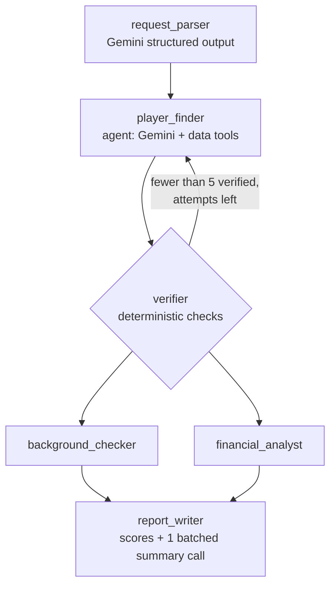

# AI Scout: an agentic football scouting pipeline

Give it a scouting brief in plain English:

```
python main.py "Find an inverted winger for Slot's Liverpool 4-3-3, under 25, budget 60M"
```

It parses the brief, lets a Gemini agent search real league data with tools, checks every name it proposes against that data and the constraints, loops back if too few survive, runs background and financial checks in parallel, and writes ranked reports with a GO / CAUTION / NO-GO verdict.

Built with LangGraph, Gemini (structured output + tool calling), a backtested forecast model (numpy/pandas), ChromaDB, Understat, Transfermarkt, ClubElo, FUTWIZ and Serper.

---

## How it works



| Step | Type | What it does |
| --- | --- | --- |
| `request_parser` | LLM, structured | Turns the brief into a validated `SearchConstraints` (role, system, budget, max age, leagues, benchmark). Falls back to keyword rules with no key or on failure. |
| `player_finder` | **Agent** | Gemini decides which tools to call and when it's done: `find_role_candidates` and `project_player` (the forecast model, when built), `search_league_players`, `get_player_stats`, `get_market_profile`, then `submit_candidates`. It is told to chase value, not names: if candidates are all expensive, search again cheaper or younger. Capped at 8 turns. Independent tool calls in one turn run concurrently. Without a key, a deterministic baseline runs instead (the model's top role scores, or top xGChain/90 without a model). |
| `verifier` | Deterministic critic | Every proposed name must resolve to a real Understat record, have enough minutes, play the role, be in a target league, and meet age and budget. Rejections are recorded with reasons and fed back to the finder on the next attempt (max 3 attempts). |
| `background_checker` | Parallel branch | Injury history (Transfermarkt), news (Serper), and a cheap-model structured read of the news for character signals. Card counts from Understat. |
| `financial_analyst` | Parallel branch | Market value, contract length, wage estimate, value-for-money and feasibility. Pure Python. |
| `report_writer` | Join | Joins results by `player_id`, scores, finds similar players, compares to the benchmark player, and writes all executive summaries in one structured call. |

### Where the numbers come from

| Data | Source | Notes |
| --- | --- | --- |
| Who the player is, minutes, goals, assists, xG, xA, npxG, shots, key passes, xGChain, xGBuildup, cards | Understat | Real current-season data, top five leagues only. One request per league, cached 24h. |
| Age, market value, contract, agent, injuries | Transfermarkt | Scraped. If value is missing, a model estimate is used and **flagged as an estimate** in the report. |
| Pace, dribbling, passing, defending, physical | FUTWIZ (EA FC) | Optional. Used by the tactical fit model when present. |
| Character signals | Serper news + Gemini Flash-Lite | Only from the retrieved snippets; snippets are passed as delimited data. |
| Candidate names | Gemini agent | Proposals only. Nothing an LLM says reaches a report unless the verifier confirms it in real data. |

When the forecast model is built, each verified candidate also gets a projection for next season at the target club with an 80% range, and the model's role score replaces the raw-stat rating in the overall score. Without it, per-90 stats are adjusted with the old hand-set league coefficients (`analysis/league_normalizer.py`).

### Scoring

All scores are deterministic and explainable (`analysis/tactical_fit.py`):

- **Tactical fit:** each system (Slot, Guardiola, Arteta, Conte, general) is a weight vector over features we have data for. Each feature is scaled 0-1 against an elite reference value. Missing features are dropped and the weights renormalised, and the report shows the **coverage** (share of the model that had data).
- **Statistical rating:** the same idea with position-specific weights.
- **Overall** = 30% tactical fit + 25% stats + 20% character + 15% value for money + 10% fitness.
- **Verdict:** GO at 70+ with low injury risk, CAUTION at 50+, NO-GO below that or when over budget.

### State

`models/workflow_state.py` is the shared LangGraph state. Each node returns **only the keys it changed**. List fields that several nodes write (`messages`, `errors`, `rejected`) use an append reducer; per-player results (`character_reports`, `financial_assessments`) are dicts keyed by `player_id` with a merge reducer, so the parallel branches never collide and results are never joined by list position.

Live objects (data-source clients, the per-run fetch memo, the trace) live in a `ContextVar` (`core/context.py`, `core/tracing.py`), not in graph state. The memo means a player's Transfermarkt profile is fetched once per run even though three steps use it.

---

## The forecast model (v3)

The agent's judgement now rests on a model fitted on past seasons. For player *i*, metric *m* (per 90), next season at club *t*:

```
y_hat = theta * (1 + lambda[league change, m, position group]   league tax
                   + beta_m  * dElo / 100                      team strength (ClubElo)
                   + gamma_m * dUsage                          expected change in his share of the team's output
                   + a_m * age_step(position group, age)       position age curve (delta method)
                   + d_m * trend / theta)                      his own recent trajectory
```

- **theta (ability)**: recency-weighted per-90 history, shrunk toward his position group's mean (empirical Bayes; the shrinkage strength is fitted per metric).
- **Relative effects**: a coefficient reads as "moving from Ligue 1 to the Premier League changes a striker's npxG/90 by X%".
- **Partial pooling**: one league effect per metric plus a more heavily penalised deviation per position group (weighted ridge).
- **Ranges**: every projection has an 80% interval whose width depends on minutes; expected minutes come from a separate model.
- **Metrics**: npxG, xA, shots, key passes, xGChain, xGBuildup (Understat). Scope: the big five, 2014/15 onward.

**Backtest.** `forecast/backtest.py` refits on past seasons only and predicts each later season, adding one term at a time against three baselines: *same as last season*, the old hand-set league coefficients, and ability only. A term stays if it lowers out-of-sample error. The report also gives 80%-interval coverage and the minutes model's error.

**Role search.** A brief becomes a role profile (`forecast/roles.py`, e.g. a John Stones replacement is `ball_playing_cb`). Retrieval finds players whose style vector (the shape of their output, level removed) is closest to the role, from a ChromaDB index. They are projected to the target club and ranked by role score, with a **value gap**: how cheap a player looks for his projected output. That is how the agent hunts for under-priced players rather than famous names.

```bash
python -m forecast.build              # download data, backtest, fit, save (needs access to understat.com,
                                      # api.clubelo.com and the Transfermarkt dataset host)
python -m forecast.build --synthetic  # same pipeline on generated data, offline
python -m forecast.build --check      # check that understat.com, the Transfermarkt dataset and ClubElo are reachable
python -m forecast.data.understat_archive  # rebuild Understat history from Internet Archive copies when understat.com is down
python -m forecast.build --elo results  # team strength from football-data.co.uk results instead of ClubElo
```

The agent loads the saved model automatically. Without it, the pipeline runs exactly as before.

Data: Understat (xG family), [transfermarkt-datasets](https://github.com/dcaribou/transfermarkt-datasets) (CC0: ages, positions, values, transfers), ClubElo (team strength). Design rationale and the research behind each term are in the project's design doc.

## Reliability, cost and observability

- **Structured output everywhere** (`core/llm.py`): every LLM call is bound to a pydantic schema via `with_structured_output`. Invalid output counts as a failure and is retried.
- **Retries** with exponential backoff and jitter on LLM calls and HTTP requests (429, 5xx, timeouts), plus per-call timeouts.
- **Graceful degradation:** a failed step records an error and falls back (keyword parser, baseline search, template summaries). Errors are printed under "Degraded steps" instead of looking like an empty result.
- **Concurrency:** per-player work runs with `asyncio.gather` under a shared semaphore (`MAX_CONCURRENCY`, default 5); background and financial checks run as parallel graph branches.
- **Cost:** one batched summary call instead of one per player, Flash-Lite for news analysis, a response cache keyed by a hash of (model, schema, messages), one shared client per model.
- **Tracing:** every run prints total time, time per step, LLM calls, cache hits, retries, tokens, estimated cost, tool calls and source requests. `--format json` includes the same under `trace`. For hosted traces, LangChain's LangSmith integration works by setting `LANGSMITH_TRACING=true` and `LANGSMITH_API_KEY`.

---

## Running it

```bash
pip install -r requirements.txt
cp .env.example .env        # add GOOGLE_API_KEY (and optionally SERPER_API_KEY)

python main.py --check      # which keys and sources are configured
python main.py "Box-to-box midfielder for Arteta's Arsenal, max 50M"
python main.py --format json "Striker under 23 from La Liga or Bundesliga"
python main.py --graph      # print the LangGraph as Mermaid
python main.py --no-cache -v "..."
```

With no keys it still runs: keyword parsing, baseline candidate search, real Understat and Transfermarkt data, template summaries.

Key settings (env or `.env`): `GEMINI_MODEL`, `GEMINI_FAST_MODEL`, `MAX_CONCURRENCY`, `FINDER_MAX_TOOL_STEPS`, `FINDER_MAX_ATTEMPTS`, `MIN_VERIFIED_CANDIDATES`, `MAX_CANDIDATES`, `LLM_CACHE`, `UNDERSTAT_SEASON`. See `config.py`.

## Tests

```bash
pytest -q
```

85 offline tests (fictional fixture data, fake Gemini, synthetic league history with known true parameters). They cover: no duplicated reports and id-based joins, each node running once with the checks fanned out, hallucinated names being rejected and the finder retrying with feedback, the loop stopping at max attempts, age/budget/minutes/role constraints, one Transfermarkt fetch per player across agents, the agent falling back when it never submits, LLM outages degrading gracefully, concurrent per-player work, LLM retries / validation / caching / cost accounting, and the parsers and scoring maths. The forecast tests check that fitting recovers the true league and team effects and age-curve shapes, that the full model beats both baselines in the backtest with calibrated intervals, that the backtest never trains on its test season, and the role search filters and ranking. CI runs them on every push (`.github/workflows/ci.yml`).

## Evals

```bash
python -m evals.run_evals --suite parse                  # parser accuracy on 16 golden queries
python -m evals.run_evals --suite pipeline --judge       # full runs + LLM-as-judge
```

| Metric | Meaning |
| --- | --- |
| field accuracy (parse) | role family, max age, budget, system, leagues, benchmark vs. expected |
| `schema_valid` | reports that validate against `ScoutingReport` |
| `unique_rate` | unique players / reports (1.0 = no duplication) |
| `constraint_pass` | reports with known age/value that meet the constraints |
| `acceptance_rate` | agent proposals that survived verification (low = proposing players that don't exist or don't fit) |
| `faithfulness` | judge score 1-5: does the summary only use the facts it was given |
| latency, LLM calls, tokens, cost | per query, plus p90 latency |

The golden set includes an adversarial prompt-injection query. Results are saved to `evals/results/`. A manual GitHub Action (`evals.yml`) runs them with the `GOOGLE_API_KEY` repository secret.

---

## Design decisions and trade-offs

- **Workflow with one agent, not agents everywhere.** Parsing, checks and scoring have a known shape, so they are fixed steps: cheaper, faster and testable. Open-ended search is where model judgment pays off, so only the finder is an agent, and it is boxed in by a deterministic verifier and a step cap.
- **The LLM proposes, data decides.** The agent never supplies stats. A name that doesn't resolve in Understat is rejected with a reason, which also makes hallucination measurable (`acceptance_rate`).
- **Deterministic scoring.** Scores come from transparent formulas over real numbers, not from asking the LLM for a number. The LLM writes prose about scores it was given.
- **Top five leagues only.** That's what Understat covers. Players elsewhere can't be verified, so they are rejected rather than scored on guesses.
- **A model, not hand-set coefficients.** League tax, team strength, usage and age are fitted on past seasons and must earn their place in a backtest. The LLM can call the model but never changes its numbers.
- **ChromaDB for role search.** Every current player's style vector, filtered by position group, rebuilt only when the data changes. A numpy fallback keeps it working without ChromaDB.

## Limitations

- Transfermarkt and FUTWIZ are scraped with browser-like headers. HTML changes break them, and scraping may conflict with their terms; the cache keeps request volume low. Treat them as best-effort enrichment.
- Understat's endpoint has changed before; `data_sources/understat_source.py` tries the JSON endpoint, then the older embedded-HTML format.
- Age comes from Transfermarkt; if it's missing the agent's claimed age is used and marked `age_source: llm_claim`.
- Wage and fallback market-value figures are heuristics.
- The forecast model's real fit needs network access to the data sources; the numbers in tests are from synthetic data.
- Free data has no defensive actions, progressive passes or carries, aerials or keeper distribution. Defender and keeper roles use xGBuildup as a proxy, and goalkeepers are not modelled.
- The Transfermarkt dataset is frozen at July 2026; current values come from the live scraper.
- Players who leave the big five drop out of the training data, so projections are conditional on the player staying in it.

## Project structure

```
main.py                     CLI
config.py                   settings (env / .env)
agents/
  scout_workflow.py         LangGraph graph + run entry points
  request_parser.py         step 1: brief -> SearchConstraints
  player_finder.py          step 2: tool-calling agent + baseline search
  verifier.py               step 3: deterministic critic + loop routing
  background_checker.py     step 4a: injuries, news, character
  financial_analyst.py      step 4b: value, contract, feasibility
  report_writer.py          step 5: scoring, similarity, batched summaries
core/
  llm.py                    shared client, structured output, retries, cache, accounting
  context.py                per-run data sources, concurrency limit, fetch memo
  tracing.py                per-run spans, tokens, cost
data_sources/               understat, transfermarkt, ea_fc_ratings, news_search, data_cache
analysis/                   tactical_fit, league_normalizer, player_comparison
                            (metrics_calculator: xT helpers, tested but unused; needs event data)
models/                     pydantic schemas for LLM I/O, candidates, reports, graph state
forecast/
  data/                     Understat history, Transfermarkt dataset + player matching, ClubElo
  table.py                  player-season table and season pairs
  model.py                  projection model (ability, league, team, usage, age, trend) + minutes model
  backtest.py               rolling backtest and ladder report
  roles.py                  role profiles, style vectors, value gap
  index.py                  ChromaDB style index
  service.py                what the agent calls: candidates() and project()
  build.py                  CLI: data -> backtest -> fit -> saved model
  synthetic.py              generated history with known answers (tests, offline demo)
evals/                      golden queries + eval runner
tests/                      offline tests with fixtures and fake Gemini
```
