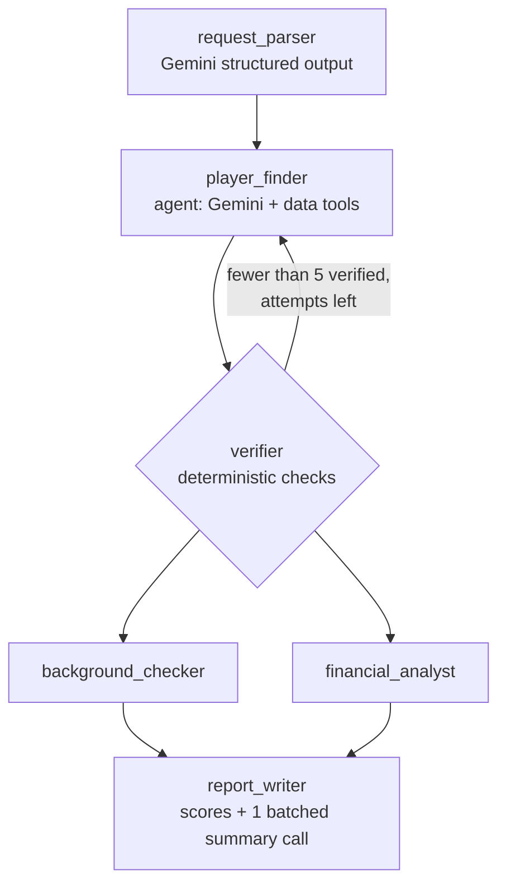

# AI Scout: an agentic football scouting pipeline

Give it a scouting brief in plain English:

```
python main.py "Find an inverted winger for Slot's Liverpool 4-3-3, under 25, budget 60M"
```

It parses the brief, lets a Gemini agent search real league data with tools, checks every name it proposes against that data and the constraints, loops back if too few survive, runs background and financial checks in parallel, and writes ranked reports with a GO / CAUTION / NO-GO verdict.

Built with LangGraph, Gemini (structured output + tool calling), Understat, Transfermarkt, FUTWIZ and Serper.

---

## How it works



| Step | Type | What it does |
| --- | --- | --- |
| `request_parser` | LLM, structured | Turns the brief into a validated `SearchConstraints` (role, system, budget, max age, leagues, benchmark). Falls back to keyword rules with no key or on failure. |
| `player_finder` | **Agent** | Gemini decides which tools to call and when it's done: `search_league_players`, `get_player_stats`, `get_market_profile`, then `submit_candidates`. Capped at 8 turns. Independent tool calls in one turn run concurrently. Without a key, a deterministic baseline (top xGChain/90 in the role) runs instead. |
| `verifier` | Deterministic critic | Every proposed name must resolve to a real Understat record, have enough minutes, play the role, be in a target league, and meet age and budget. Rejections are recorded with reasons and fed back to the finder on the next attempt (max 3 attempts). |
| `background_checker` | Parallel branch | Injury history (Transfermarkt), news (Serper), and a cheap-model structured read of the news for character signals. Card counts from Understat. |
| `financial_analyst` | Parallel branch | Market value, contract length, wage estimate, value-for-money and feasibility. Pure Python. |
| `report_writer` | Join | Joins results by `player_id`, scores, finds similar players, compares to the benchmark player, and writes all executive summaries in one structured call. |

### Where the numbers come from

| Data | Source | Notes |
| --- | --- | --- |
| Who the player is, minutes, goals, assists, xG, xA, npxG, shots, key passes, xGChain, xGBuildup, cards | Understat | Real current-season data, top five leagues only. One request per league, cached 24h. |
| Age, market value, contract, agent, injuries | Transfermarkt | Scraped. If value is missing, a model estimate is used and **flagged as an estimate** in the report. |
| Pace, dribbling, passing, defending, physical | FUTWIZ (EA FC) | Optional. Used by the tactical fit model when present. |
| Character signals | Serper news + Gemini Flash-Lite | Only from the retrieved snippets; snippets are passed as delimited data. |
| Candidate names | Gemini agent | Proposals only. Nothing an LLM says reaches a report unless the verifier confirms it in real data. |

Per-90 stats are adjusted to Premier League equivalence with league coefficients (`analysis/league_normalizer.py`).

### Scoring

All scores are deterministic and explainable (`analysis/tactical_fit.py`):

- **Tactical fit:** each system (Slot, Guardiola, Arteta, Conte, general) is a weight vector over features we have data for. Each feature is scaled 0-1 against an elite reference value. Missing features are dropped and the weights renormalised, and the report shows the **coverage** (share of the model that had data).
- **Statistical rating:** the same idea with position-specific weights.
- **Overall** = 30% tactical fit + 25% stats + 20% character + 15% value for money + 10% fitness.
- **Verdict:** GO at 70+ with low injury risk, CAUTION at 50+, NO-GO below that or when over budget.

### State

`models/workflow_state.py` is the shared LangGraph state. Each node returns **only the keys it changed**. List fields that several nodes write (`messages`, `errors`, `rejected`) use an append reducer; per-player results (`character_reports`, `financial_assessments`) are dicts keyed by `player_id` with a merge reducer, so the parallel branches never collide and results are never joined by list position.

Live objects (data-source clients, the per-run fetch memo, the trace) live in a `ContextVar` (`core/context.py`, `core/tracing.py`), not in graph state. The memo means a player's Transfermarkt profile is fetched once per run even though three steps use it.

---

## Reliability, cost and observability

- **Structured output everywhere** (`core/llm.py`): every LLM call is bound to a pydantic schema via `with_structured_output`. Invalid output counts as a failure and is retried.
- **Retries** with exponential backoff and jitter on LLM calls and HTTP requests (429, 5xx, timeouts), plus per-call timeouts.
- **Graceful degradation:** a failed step records an error and falls back (keyword parser, baseline search, template summaries). Errors are printed under "Degraded steps" instead of looking like an empty result.
- **Concurrency:** per-player work runs with `asyncio.gather` under a shared semaphore (`MAX_CONCURRENCY`, default 5); background and financial checks run as parallel graph branches.
- **Cost:** one batched summary call instead of one per player, Flash-Lite for news analysis, a response cache keyed by a hash of (model, schema, messages), one shared client per model.
- **Tracing:** every run prints total time, time per step, LLM calls, cache hits, retries, tokens, estimated cost, tool calls and source requests. `--format json` includes the same under `trace`. For hosted traces, LangChain's LangSmith integration works by setting `LANGSMITH_TRACING=true` and `LANGSMITH_API_KEY`.

---

## Running it

```bash
pip install -r requirements.txt
cp .env.example .env        # add GOOGLE_API_KEY (and optionally SERPER_API_KEY)

python main.py --check      # which keys and sources are configured
python main.py "Box-to-box midfielder for Arteta's Arsenal, max 50M"
python main.py --format json "Striker under 23 from La Liga or Bundesliga"
python main.py --graph      # print the LangGraph as Mermaid
python main.py --no-cache -v "..."
```

With no keys it still runs: keyword parsing, baseline candidate search, real Understat and Transfermarkt data, template summaries.

Key settings (env or `.env`): `GEMINI_MODEL`, `GEMINI_FAST_MODEL`, `MAX_CONCURRENCY`, `FINDER_MAX_TOOL_STEPS`, `FINDER_MAX_ATTEMPTS`, `MIN_VERIFIED_CANDIDATES`, `MAX_CANDIDATES`, `LLM_CACHE`, `UNDERSTAT_SEASON`. See `config.py`.

## Tests

```bash
pytest -q
```

57 offline tests (fictional fixture data, fake Gemini). They cover: no duplicated reports and id-based joins, each node running once with the checks fanned out, hallucinated names being rejected and the finder retrying with feedback, the loop stopping at max attempts, age/budget/minutes/role constraints, one Transfermarkt fetch per player across agents, the agent falling back when it never submits, LLM outages degrading gracefully, concurrent per-player work, LLM retries / validation / caching / cost accounting, and the parsers and scoring maths. CI runs them on every push (`.github/workflows/ci.yml`).

## Evals

```bash
python -m evals.run_evals --suite parse                  # parser accuracy on 16 golden queries
python -m evals.run_evals --suite pipeline --judge       # full runs + LLM-as-judge
```

| Metric | Meaning |
| --- | --- |
| field accuracy (parse) | role family, max age, budget, system, leagues, benchmark vs. expected |
| `schema_valid` | reports that validate against `ScoutingReport` |
| `unique_rate` | unique players / reports (1.0 = no duplication) |
| `constraint_pass` | reports with known age/value that meet the constraints |
| `acceptance_rate` | agent proposals that survived verification (low = proposing players that don't exist or don't fit) |
| `faithfulness` | judge score 1-5: does the summary only use the facts it was given |
| latency, LLM calls, tokens, cost | per query, plus p90 latency |

The golden set includes an adversarial prompt-injection query. Results are saved to `evals/results/`. A manual GitHub Action (`evals.yml`) runs them with the `GOOGLE_API_KEY` repository secret.

---

## Design decisions and trade-offs

- **Workflow with one agent, not agents everywhere.** Parsing, checks and scoring have a known shape, so they are fixed steps: cheaper, faster and testable. Open-ended search is where model judgment pays off, so only the finder is an agent, and it is boxed in by a deterministic verifier and a step cap.
- **The LLM proposes, data decides.** The agent never supplies stats. A name that doesn't resolve in Understat is rejected with a reason, which also makes hallucination measurable (`acceptance_rate`).
- **Deterministic scoring.** Scores come from transparent formulas over real numbers, not from asking the LLM for a number. The LLM writes prose about scores it was given.
- **Top five leagues only.** That's what Understat covers. Players elsewhere can't be verified, so they are rejected rather than scored on guesses.
- **numpy instead of a vector database.** A pool of 10-20 players doesn't need one.

## Limitations

- Transfermarkt and FUTWIZ are scraped with browser-like headers. HTML changes break them, and scraping may conflict with their terms; the cache keeps request volume low. Treat them as best-effort enrichment.
- Understat's endpoint has changed before; `data_sources/understat_source.py` tries the JSON endpoint, then the older embedded-HTML format.
- Age comes from Transfermarkt; if it's missing the agent's claimed age is used and marked `age_source: llm_claim`.
- Wage and fallback market-value figures are heuristics.
- League coefficients are hand-set approximations.

## Project structure

```
main.py                     CLI
config.py                   settings (env / .env)
agents/
  scout_workflow.py         LangGraph graph + run entry points
  request_parser.py         step 1: brief -> SearchConstraints
  player_finder.py          step 2: tool-calling agent + baseline search
  verifier.py               step 3: deterministic critic + loop routing
  background_checker.py     step 4a: injuries, news, character
  financial_analyst.py      step 4b: value, contract, feasibility
  report_writer.py          step 5: scoring, similarity, batched summaries
core/
  llm.py                    shared client, structured output, retries, cache, accounting
  context.py                per-run data sources, concurrency limit, fetch memo
  tracing.py                per-run spans, tokens, cost
data_sources/               understat, transfermarkt, ea_fc_ratings, news_search, data_cache
analysis/                   tactical_fit, league_normalizer, player_comparison
                            (metrics_calculator: xT helpers, tested but unused; needs event data)
models/                     pydantic schemas for LLM I/O, candidates, reports, graph state
evals/                      golden queries + eval runner
tests/                      offline tests with fixtures and fake Gemini
```
